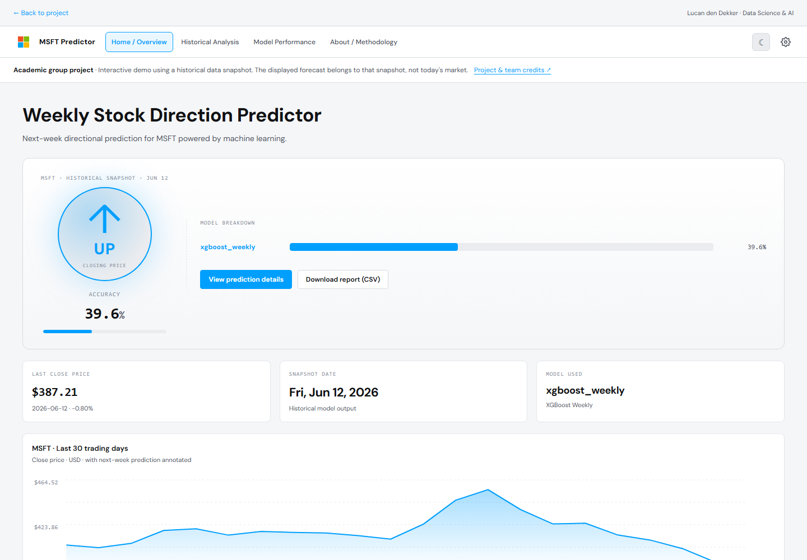

# MSFT Stock Predictor

**A team project about managing a shared Data Science lifecycle, using stock-direction prediction as the technical challenge.**

Developed as a group project during **Year 1, Block D: Data Science Lifecycle Management** at Breda University of Applied Sciences. This portfolio copy is maintained by Lucan den Dekker. It is **group work**, not a solo application.

## What this project demonstrates

The main learning goals were collaboration and project delivery: organising work with **Kanban**, dividing responsibilities, coordinating dependencies, communicating changes and integrating individual contributions into one application. The stock-market task gave us a shared problem around which to practise those skills.

- **Kanban and planning:** making work visible, assigning ownership and tracking progress.
- **Team coordination:** keeping the proposal, model experiments, data pipeline and dashboard aligned.
- **Git collaboration:** working on branches, resolving conflicts and agreeing to sync with main more frequently.
- **Documentation:** reviewing shared documents when the modelling task and application design changed.
- **Integration:** connecting data preparation, experiments, database storage, tests and a dashboard.

Read the [teamwork case study](docs/teamwork.md) for concrete examples and [team attribution](AUTHORS.md) for authorship.

## My contribution

The project records identify my work on the presentation template, problem statement and project timeline. This repository also includes five notebooks from my experiment folder, covering successive modelling approaches. These are my contributions within a shared project; the final dashboard model is the group's weekly XGBoost model, credited in the source code to Timur's work.

## The technical task

Explore whether historical Microsoft (MSFT) data and peer-stock signals can classify the **following week's direction** as up, down or neutral. The final implementation uses weekly features and a three-class XGBoost model, with a Flask dashboard and SQLite storage. Earlier design documents describe a daily/binary task and Streamlit; they reflect an earlier stage, not the final implementation.



This is an **academic prototype**, not a trading system. Predictive performance was limited and close to simple baselines. The saved final-model metadata reports approximately **39.6% three-class accuracy** and **0.376 F1**. These are archived evaluation results, not a fresh evaluation or evidence of an investment advantage. The project is presented for the teamwork and engineering process, not for a claim to reliably predict markets.

## Current-data dashboard and Hugging Face

The Gradio entry point wraps the original dashboard and Python API. It fetches the latest available quote and refreshes completed market sessions and model output on access. Data status, quote time, input week and forecast week are displayed explicitly. The saved model is not automatically retrained.

```sh
python -m pip install -r requirements-gradio.txt
python app.py
```

Open **http://localhost:7860**. Prepare the Space upload with `python tools/package_space.py --output upload`. See [Hugging Face deployment](docs/huggingface.md) for the Gradio/ZeroGPU package and limitations.

The most recent completed input week predicts the following trading week's direction. It does not estimate tomorrow's price. Quote refreshes do not change that forecast horizon. The Space can be embedded in a Hostinger portfolio without running Python at Hostinger.

## Run the dashboard locally

Use **Python 3.12**. The Flask server refreshes data automatically by default. Set `MSFT_AUTO_REFRESH=0` to use only the included historical snapshots and local setup below.

```sh
python -m venv .venv
```

```powershell
# Windows PowerShell
.venv\Scripts\Activate.ps1
```

```sh
# macOS / Linux
source .venv/bin/activate
```

```sh
python -m pip install -r requirements.txt
python dashboard/setup_db.py
python dashboard/msft_forecaster/predict.py
python dashboard/server.py
```

Open **http://localhost:5002**. The market quote tile fetches the latest available MSFT quote from Yahoo Finance, includes the source timestamp and refreshes every minute while the page is visible. Market-data delays and closed sessions can mean the latest quote is older than the current time.

Charts and model output still use the historical snapshot. The current quote does not turn that output into a live prediction. If the quote provider is unavailable, the interface shows an error or labels the last received quote as stale. Read the [data correction and quote notes](docs/data-correction.md).

Alternatively:

```sh
docker compose up --build
```

The Docker container serves on port 7860; Docker Compose maps it to localhost:5002. The included Docker configuration supports Hugging Face Spaces. Read the [deployment instructions](docs/huggingface.md) for the upload layout and validation limits.

## Optional data refresh

```sh
python dashboard/setup_db.py --refresh
python dashboard/msft_forecaster/predict.py
```

This explicitly downloads data through `yfinance`, rebuilds the database and clears old stored forecasts. It does **not** retrain or revalidate the saved model. Network access and upstream data availability are required. The original CSV-fetch utility is retained as research code; it updates CSVs and is not the dashboard database refresh entry point.

## Repository contents

```text
dashboard/server.py                    Flask dashboard API
dashboard/setup_db.py                  Offline snapshot setup / optional refresh
dashboard/static/                      Original group dashboard
dashboard/data/                        Historical input snapshots and model dataset
dashboard/msft_forecaster/predict.py   Weekly inference and prediction storage
dashboard/msft_forecaster/pipeline/    Group feature and training code + saved model
notebooks/lucan/                       My five experiment notebooks
docs/teamwork.md                       Kanban, coordination and reflection
AUTHORS.md                             Group attribution
tests/                                 Dashboard and real-model checks
```

The notebooks have execution outputs cleared and are retained as research artefacts. They need their own original datasets and additional modelling libraries such as PyTorch, statsmodels or Prophet; the dashboard requirements do not install every experimental dependency. Retraining code additionally requires Optuna. Training and every historical notebook have not been rerun.

## Data and presentation

Historical market snapshots come from the group's Yahoo Finance / `yfinance` workflow. Oil and SPY snapshots were exported from the original project database; the remaining raw series came from the original CSVs. Their date coverage can differ. Source data and third-party libraries retain their original terms. The snapshot is not redistributed as a live market feed.

This portfolio copy makes a few practical changes: an offline-first setup, a configurable local port, recorded-only prediction history and model metrics loaded from the saved final-model metadata. No private meeting transcript, assessment documents, school API address or old Git history is published. The original group authorship is retained in this README, source comments and `AUTHORS.md`.

## Validation

```sh
python -m pip install -r requirements-dev.txt
python -m pytest -q
```

Tests check offline database setup, real model loading and prediction, dashboard endpoints and the absence of fabricated prediction history. They do not demonstrate future predictive performance.
